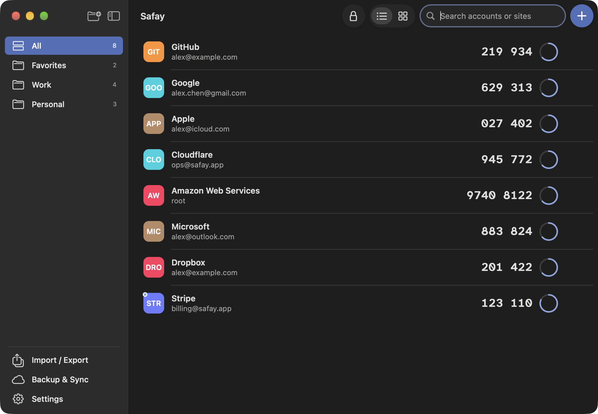
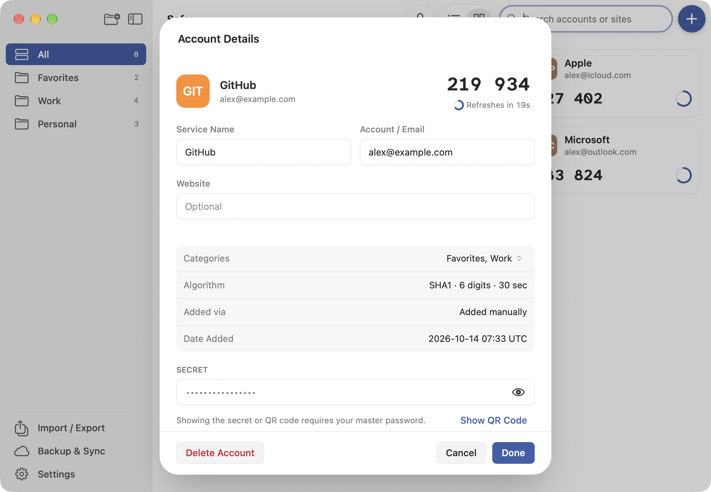

# Safay

Safay is a two-factor authenticator for the Mac, built with Native Shell. It keeps your TOTP accounts in a local, end-to-end encrypted vault, shows the current codes, and backs the vault up to a location you choose, without a Safay account or server.

## Codes at a glance

Accounts appear as cards or a compact list, each with a colored monogram or the site's own icon, the current code and a countdown ring. One click copies a code. Search, categories with multiple membership and drag to reorder keep a long list manageable. Safay supports TOTP with SHA-1, SHA-256 and SHA-512, 6 or 8 digits and 30 or 60 second periods, plus Steam Guard and Battle.net.

## Adding accounts

Enter a setup key, paste otpauth links (including Google Authenticator migration codes), drop QR code images, select a QR code on screen or scan one with the camera. Backups from Aegis, 2FAS, Ente Auth, Proton Authenticator, Authenticator and Bitwarden import directly, as do CSV exports from Apple Passwords and other password managers.

## A vault that stays yours

The vault is protected by a master password with Argon2id and AES-256-GCM, and Touch ID is backed by the Secure Enclave. Safay locks automatically, on sleep and on screen lock. Showing a secret or QR code, exporting and copying from a launcher all ask for Touch ID or the master password first.

## Backup and sync

Only the encrypted vault leaves the Mac: to iCloud, Nextcloud, WebDAV or any folder, such as one synced by another app. When two devices change the vault, Safay compares the versions and lets you resolve the conflict instead of silently overwriting either.

## Always within reach

A menu bar panel and global shortcuts bring up codes from anywhere, and Alfred, Raycast and Tinycast can search your accounts and ask Safay to copy a code. Safay is available in English, Simplified Chinese and Traditional Chinese, in light and dark appearance.

[GitHub repository](https://github.com/gicek/safay)
